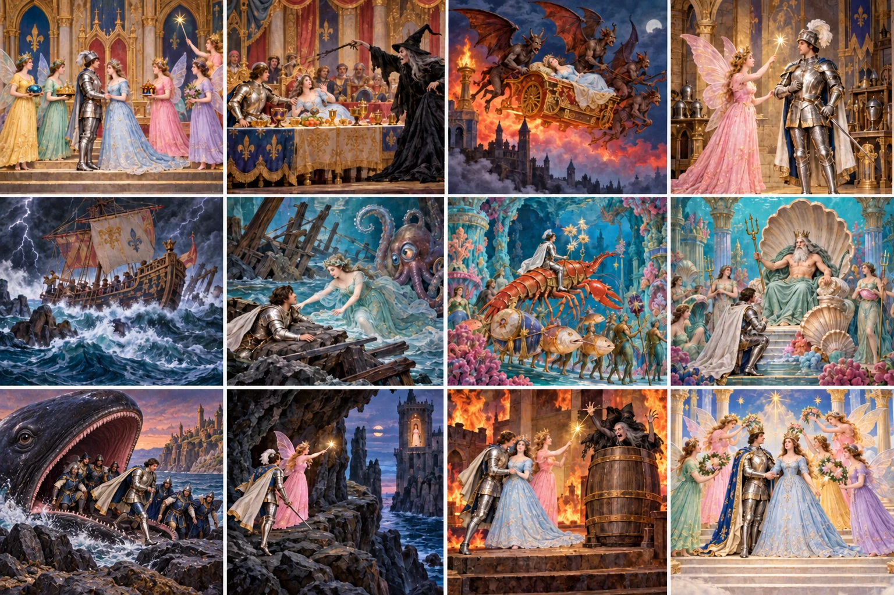

# Kingdom of the Fairies — original film story

*Le Royaume des fées*, Georges Méliès, France, 1903, Star Film 483–498,
approximately 16–17 minutes. This is the narrative reference for future design.

## Cast and causal thread

Prince **Bel-Azor** seeks his kidnapped fiancée **Princess Azurine**.
**Aurora**, Azurine’s fairy godmother, helps him. The excluded **witch** is
the antagonist; her demons abduct Azurine and set the prison ablaze.
The **Fairy of the Waters / Mermaid Queen** rescues the shipwrecked party;
**Neptune** grants passage back to land. Aurora and the witch are distinct.
Azurine remains captive until the burning-castle rescue: she does not travel
with the underwater party or ride the whale.

## Complete sequence

The following outline follows the 32-tableau Méliès catalogue transcribed by
GRIMH. Grouping is for design, not a claim about edit boundaries in every copy.

| Tableaux | Story action | Visual reference |
| --- | --- | --- |
| 1–3 | Betrothal, four fairy gifts, an uninvited witch’s curse. | Royal court, ring, flowers, crown, gold, cradle. |
| 4–7 | Azurine sleeps; the witch destroys her protective flower. Demons kidnap her in a fiery flying chariot; the court raises the alarm. | Shell bed, trapdoor, rampart, airborne procession. |
| 8–9 | The court arms itself. The witch shows Bel-Azor a vision of Azurine confined in an isolated tower, then binds him. | Armoury dissolves into the prison vision. |
| 10–11 | Aurora frees him and summons magical protection; he is equipped and knighted. | Enchanted armour, helmet, sword; fairy gesture. |
| 12–15 | The royal galley departs. The witch summons a storm; rocks wreck the ship, which sinks. | Rolling water, lightning, wreck, sea nymphs. |
| 16–18 | The water fairy revives the voyagers near an octopus and leads their fantastic marine procession. | Conch carriage, dolphin, fish and lobster mounts. |
| 19–21 | Lobster palace and sea flora transform into the azure grotto and Neptune’s court. | Coral, shells, pearls, throne, aquatic attendants. |
| 22–23 | Neptune supplies a whale transport; it swallows the party and delivers them ashore. Aurora indicates a cave route toward the tower. | Whale mouth, shore, cavern entrance. |
| 24–25 | The party reaches a cliff. Bel-Azor dives and swims toward the isolated prison; Aurora counters the pursuing witch. | Precipice, sea gap, distant tower. |
| 26–27 | Bel-Azor breaks in. Demons burn the castle; he carries Azurine down the collapsing stairs and escapes. | Torches, smoke, broken stair and falling scenery. |
| 28–29 | The witch attacks again. With Aurora’s intervention she is confined in a barrel and cast into the sea. | Barrel, cliff, whirlpool. |
| 30–32 | The wedding procession returns to court; clouds dissolve into the fairy kingdom’s final crowning tableau. | Palanquin, banners, airborne fairies, marble colonnade. |

## Source differences

The Lubin catalogue’s 35-tableau version also advertises prehistoric monsters,
a boa, a waterfall and a dance of boots in the cavern. Keep these as catalogue
variants until a chosen viewing copy confirms them; do not silently mix them
into the 32-tableau sequence. Tableau numbers differ in Lobster’s modern retelling.
The barrel action is also attributed differently in summaries. Design should
preserve the unambiguous outcome and verify staging against the chosen film copy.
The film ends in reunion and marriage, rather than the current game’s rose
bargain and three possible endings.

## Images and how to read them

Twelve new concept panels read left-to-right, top-to-bottom: betrothal, curse,
abduction, arming, wreck, underwater rescue, marine procession, Neptune,
whale/shore, cave/cliff, burning rescue/barrel, wedding/apotheosis.
These are generated interpretations, not film stills. Panel 9 was corrected to show the prince and his party leaving the whale’s mouth,
with Azurine still captive elsewhere. Panel 7 exaggerates the mount scale,
and panel 11 compresses rescue and punishment into one image.
The text and linked film outrank those illustrative shortcuts.

Existing source-led studies add detailed views of the court, rampart, chariot,
armoury, prison vision, hooded witch, demons, fairy gifts and sea moat:
[expanded-world gallery](references/expanded-world/index.html).
For exact staging consult its captured source frames and the film itself.

## Sources checked 10 October 2026

- [La Cinémathèque française — film and cast](https://www.cinematheque.fr/film/52514.html).
- [GRIMH — historical Méliès and Lubin catalogue transcriptions](https://www.grimh.org/index.php?Itemid=677&id=1361&lang=es&layout=edit&option=com_content&view=article).
- [Lobster Films — tableau retelling](https://melies.lobsterfilms.com/contes.php).
- [Sprocket Society — screening notes](https://sprocketsociety.org/pdf/georges_melies-impossible_voyager_program-notes.pdf).
- [Wikimedia Commons — full film viewing copy](https://commons.wikimedia.org/wiki/File:Le_Royaume_des_f%C3%A9es_(1903).webm).

The 1903 film is the primary visual reference. Modern scores/restorations and
generated interpretations are separate materials, not evidence of an original
fixed soundtrack or exact prop design.
