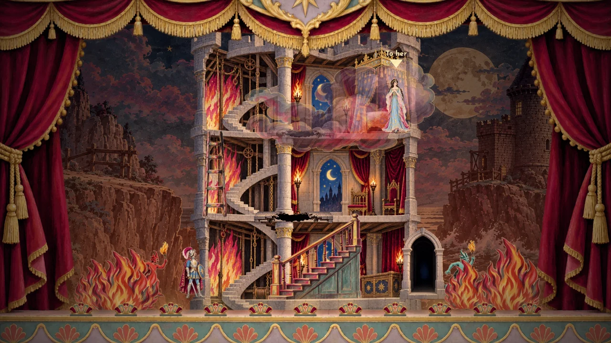
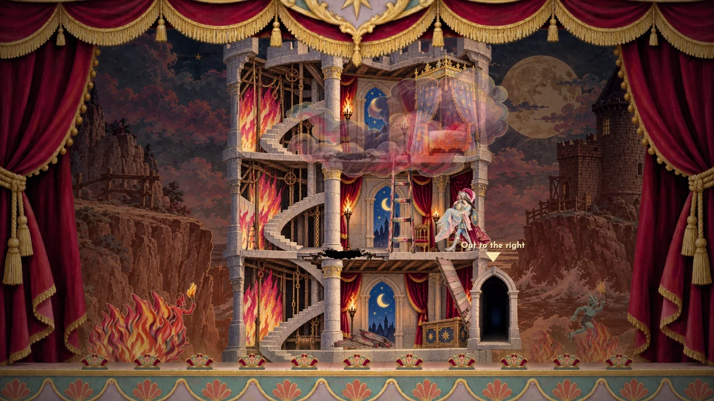
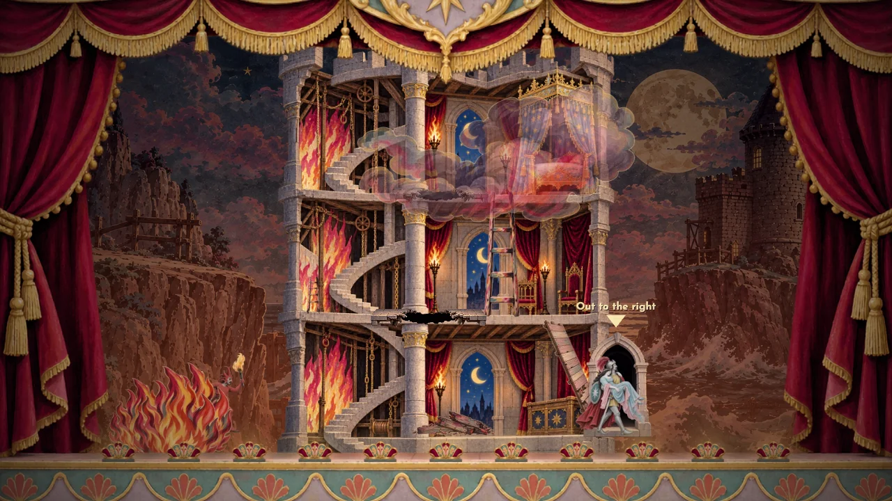
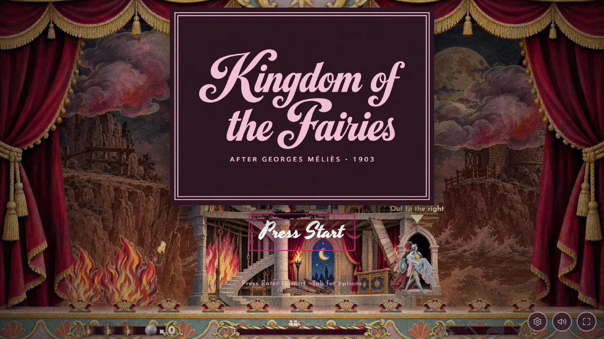

# The right-hand tower escape — 31 October 2026

Once Azurine is lifted, the exterior fires on the right shrink and fade over
eight seconds. Descent also clears them, guaranteeing zero flames at the
ground floor even if the player takes a quicker route. Their minimum level
is retained so climbing upward cannot rekindle them. Waiting at the top also
extinguishes them. The torch-bearing right demon retreats and fades with the
fire, leaving the ground-level escape visibly clear. Left-side fire remains.
Smoke above the building and its painted interior flames remain part of the
burning tower; no fire or torch stays across the right escape route.

The film rescue exits at the right wall through a new painted open stone
arch; the old left-side rescue trigger is disabled. Goal text and the rescue
announcement point right. Only the film act opts into the shared right-exit
configuration: the original and partial editions retain their left exit.
The fire clock and minimum fire level are included in rescue checkpoints.

New artwork: `assets/tower-escape-door.webp`, 160 × 250, bottom centre.
Generated with the built-in image tool and imagegen skill against the existing
tower interior. [Exact prompt/reference record](generation.json), [native
source](source.png). `design/source/prepare_tower_escape_door.py` reproduces
alpha trimming and packaging. The sprite audit reports nothing to redraw;
unrelated bosun template drift was discarded to preserve its calibration.

Validation: 45 film checks include real pickup and descent through the ladder
and slope, full clearance by the ground, no left-side exit, the right escape,
waiting, checkpoints and no rekindling. Both original/partial Act V suites
pass. `qa/tower-escape-browser.mjs` verifies both looks at full/fading/zero
fire, the right-hand doorway, left fire retained, the right demon gone at
zero, and a complete real keyboard pickup/ladder/slope/right-door traversal.
[Browser evidence](checks.json).

