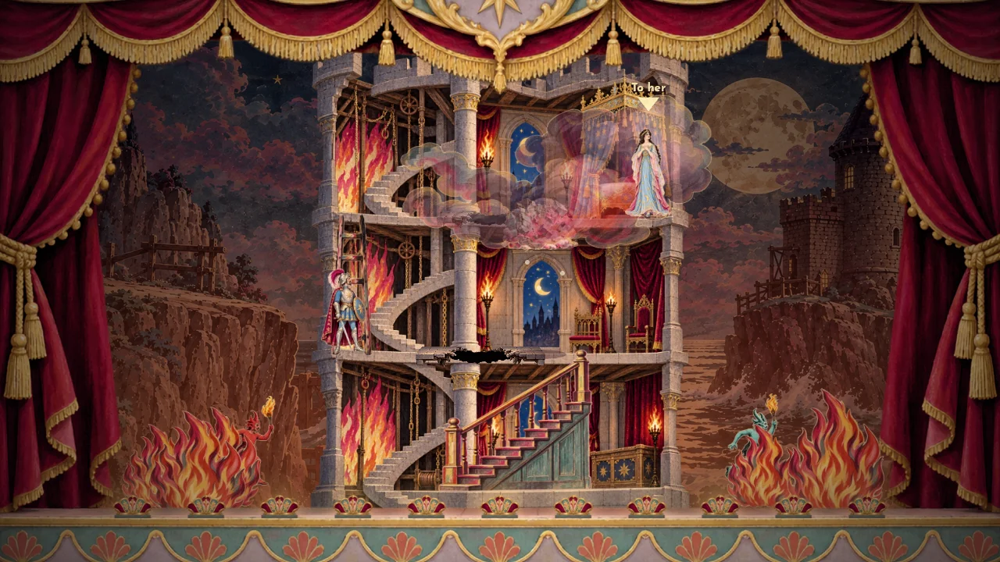
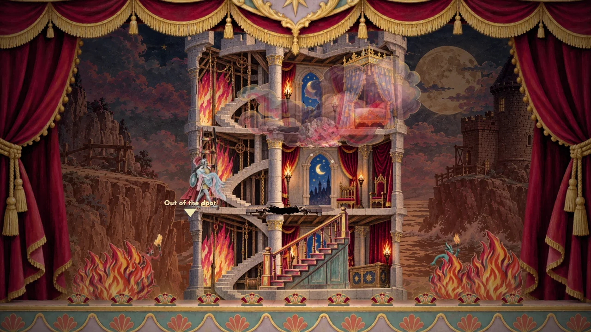

# Tower pits and warning-badge cleanup — 31 October 2026

The tower had flat dark rectangles and pulsing orange ellipses over its two
actual collision gaps. These are replaced by the delivered painted breach:
fractured limestone, charred supports and an opaque irregular shadow. The
shadow covers the continuous floor on the existing cloth so a dangerous gap
remains readable; the surrounding transparent edge blends into its stone.
The opening occupies about 42% of the generated cutout, measured in review;
drawing aligns that opening with each actual collision gap rather than
stretching the whole sprite over the gap. The artwork replaces the geometric
pit cues, without changing collision or rescue mechanics.

The original and partial editions retain their existing painted wooden
floor-hole art, with their added glowing ellipses removed too.

All legacy badge fallback branches in Acts II–IV are removed, along with
preloading the now-unused omen-token. The shared renderer uses a particle
shimmer; tower/cliff hazards use natural grit and dust. No warning path draws
a keepsake on a circular disc. The badge removal already on main was still
unpublished when this request was made, so the older live release continued
to show it until a new production release could be approved.

Generated with the built-in image tool and imagegen skill. [Exact prompt and
references](generation.json), [preserved native PNG](source.png).
`design/source/prepare_tower_breach.py` reproduces alpha trimming and resizing
into `assets/tower-floor-breach.webp` (600 × 95, centre-anchored prop).
The full sprite audit found nothing to redraw; its unrelated bosun template
measurement drift was discarded to preserve the existing calibration.
No character sprites or character-size measurements changed.

Validation: both legacy/partial five-act suites, all 43 film checks, asset
request generator check, and `qa/tower-interior-browser.mjs`. The browser
checks both looks before/after rescue, confirms both painted gaps are drawn,
and sees no omen-token request or old pit ellipse. [Results](checks.json).

