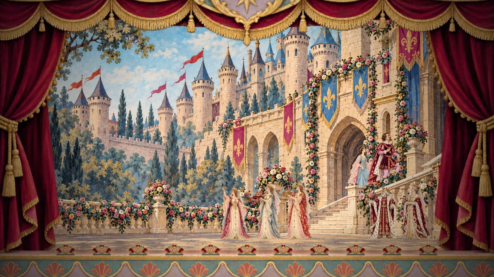
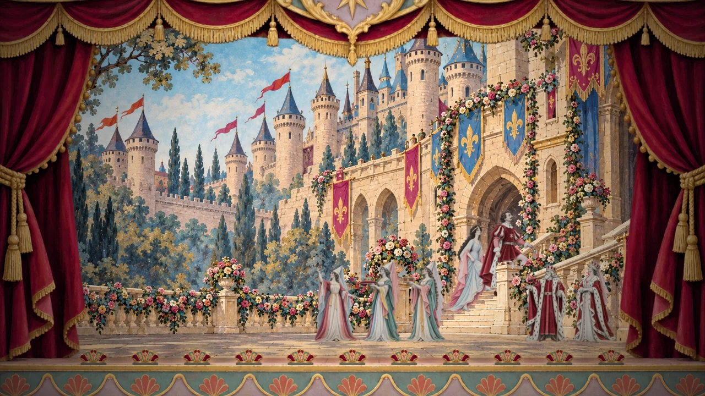
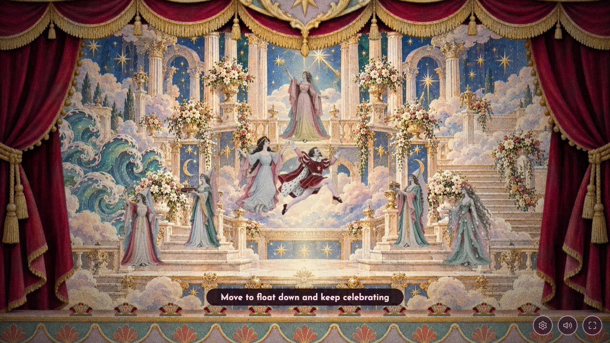
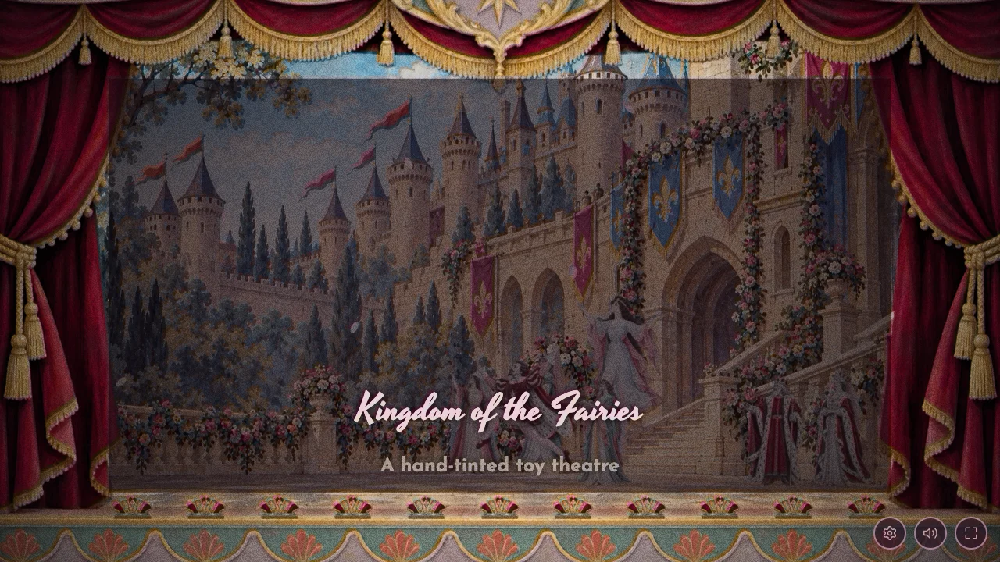

# Wedding stairs and credits free play — 31 October 2026

Eight transparent stair poses generated with the built-in image tool using the
imagegen skill. Exact prompts, references and raw output names are retained in
[generation.json](generation.json); all eight native PNGs are in [source/](source/).
Delivered WebPs are `assets/{prince-court,azurine}-stairs-{a,b}[-tinted].webp`.
Frame B makes a restrained weight/foot change rather than a large stride.

`design/source/prepare_wedding_stairs.py` trims alpha and packages bottom-centred
320 × 440 prince / 300 × 440 Azurine canvases. No repainting, recolouring,
background replacement or artificial alpha removal. Character measurements in
`person_sizes.py` keep their full painted figure at the same person height in
both stair frames, reviewed beside standing sprites and animated in play.
`audit_sprites.py` passes canvas/feet checks and reports nothing to redraw.
Its unrelated bosun tumble template drift was discarded, preserving the
existing calibration. [Prince comparison](prince-court-sizes.jpg) and
[Azurine comparison](azurine-sizes.jpg).

The foreground mask is code-native: `src/wedding-foreground.js` clips exact
pixels from the existing wedding cloth around the rail, newels, balusters,
garlands, banners and door jambs. Gaps between balusters remain open. The route
tracks the painted stair treads and then crosses the dark doorway. There is
no destination oval. Entry waits for both characters; movement toward the
door is required so returning outside cannot immediately re-enter at high
refresh rates. Either horizontal movement or up/down works on the stairs.

Holding left at the final tableau’s exit for one second returns to the same street, petals and
score. They automatically descend a little way from the doorway before
control resumes, even if forward is already held. The first light jump saves completion and starts one credit clock.
The couple hold their elevated pose until directional movement releases them
into a two-second descent. Further light jumps repeat the slow ascent/hold
without restarting the credits. Wedding music and free movement continue
after the roll, across both sets.

Verified with the legacy and partial five-act suites, shared animation,
sailor-motion, walking, theme, assets-loader and finale suites; 42 film checks;
asset request generators and person-size fingerprint. Browser reviews cover
real keyboard traversal, high-refresh return regression, repeated light jumps,
vertical-input release, paused credits, continuous decoded wedding audio and
both original/tinted masks. Audio evidence: [audio-and-timing.json](audio-and-timing.json).

