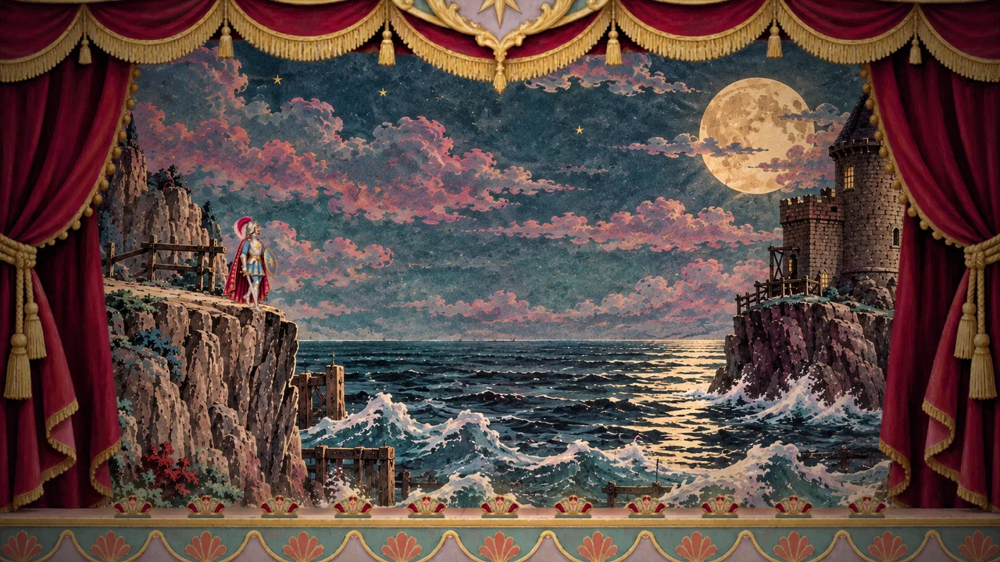
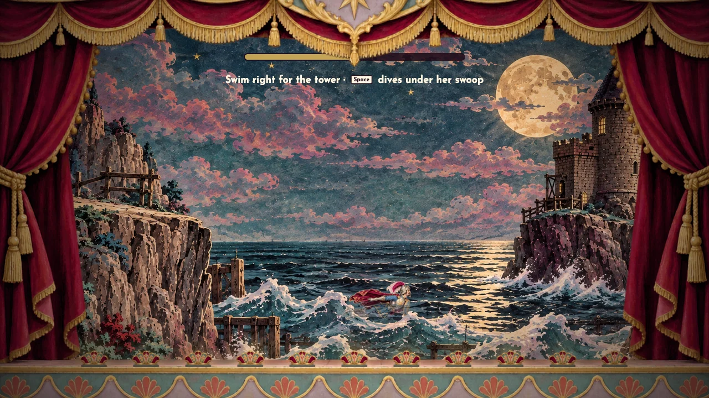
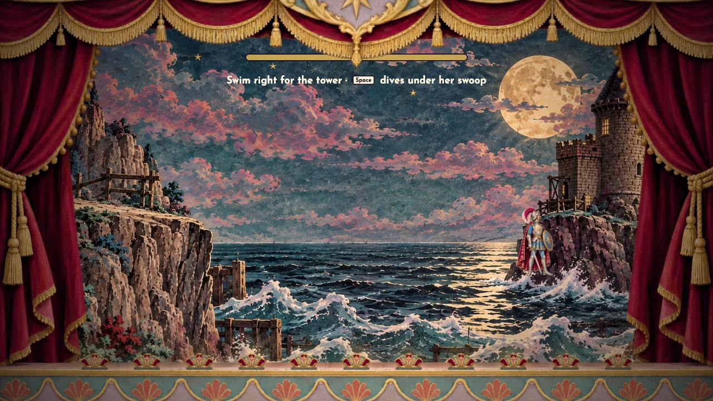
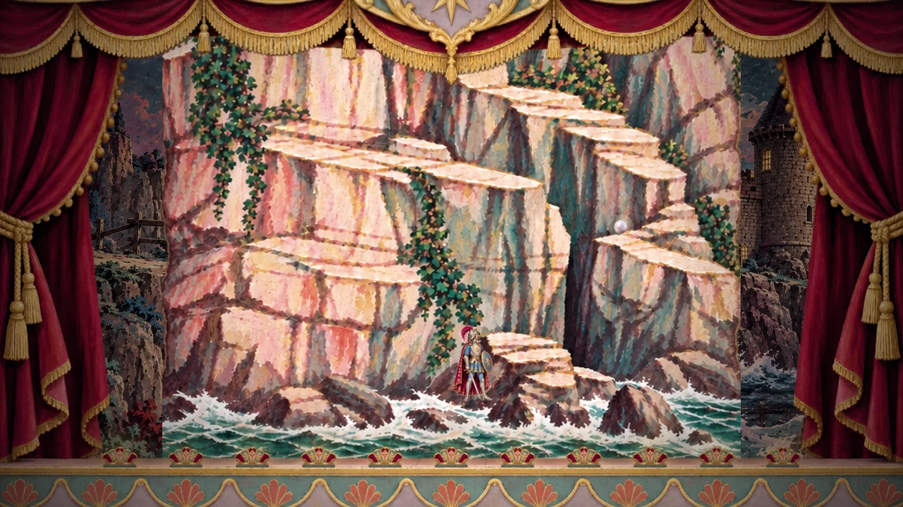

# Coast and artwork review — 31 October 2026

The circled star was the legacy omen bonus token: collecting all three voyage
keepsakes grants earlier hazard tells. Its badge is removed throughout the
renderer. Underwater early tells now use a rising particle shimmer; cliff and
burning-building tells use loose grit and soft, irregular dust emitters.
The environmental rockfalls have no hidden attacker. Existing delivered
`debris-stones` art remains the damaging stone, with a particulate trail.
Painted ivy is no longer covered with procedural vine grips.

The cliff-edge destination oval, arrow and dive text are removed. Feet follow
the painted coast path; walking right automatically dives into the channel.
The dive lands around the swim route's starting point rather than far beyond
it. The same cloth stays registered in the dive and swim shots. The swimmer
travels across open water instead of staying screen-fixed in a panning cliff.
Net swimming speed changes from 195 to 330 world units/sec (about 41% less
crossing time). A 1.1-second far-bank arrival finishes the crossing visibly,
using delivered mantle/standing poses before cutting to the tower wall.

`qa/coast-browser.mjs` audits all 36 film scene entries in both cast styles,
three sampled moments each: **216 frames, 160 drawn asset identities, zero
missing draw requests, zero requested slots, zero failed image loads**.
[Machine-readable result](artwork-audit.json). This is a representative scene
sweep, supplemented by actual keyboard traversal and the headless gameplay
suites; it does not claim to enumerate every possible animation state.
All manifest image files load successfully, including those outside the
sampled drawing states. Older compatibility fallback code remains, but a
failed manifest/image load now prevents leaving the intertitle and displays
a reload instruction, so gameplay cannot silently substitute procedural art.
Optional animation loops can still fall back to delivered still artwork.

Remaining generated drawing inside play is explicit effects (dust/grit,
water masks and ripples, magical glimmers, sparks, fire, shadows, fade/iris)
or UI; characters, sets and physical props use delivered artwork. No new
raster generation was needed for this request.

Validation: 43 film checks; both original/partial five-act suites; shared
animation, sailor-motion, walking, theme, assets-loader and finale tests;
real browser scene sweep, automatic dive/channel traversal, bank arrival,
and an intentionally blocked artwork download staying on the loading card.

