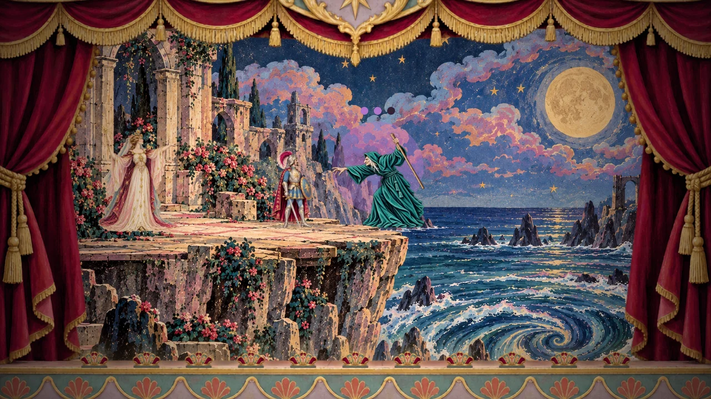
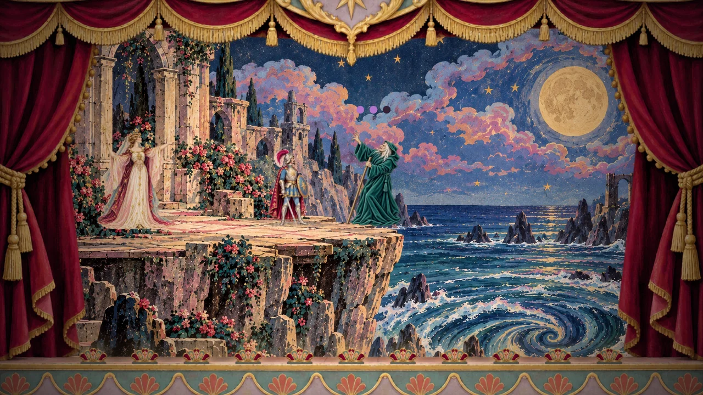
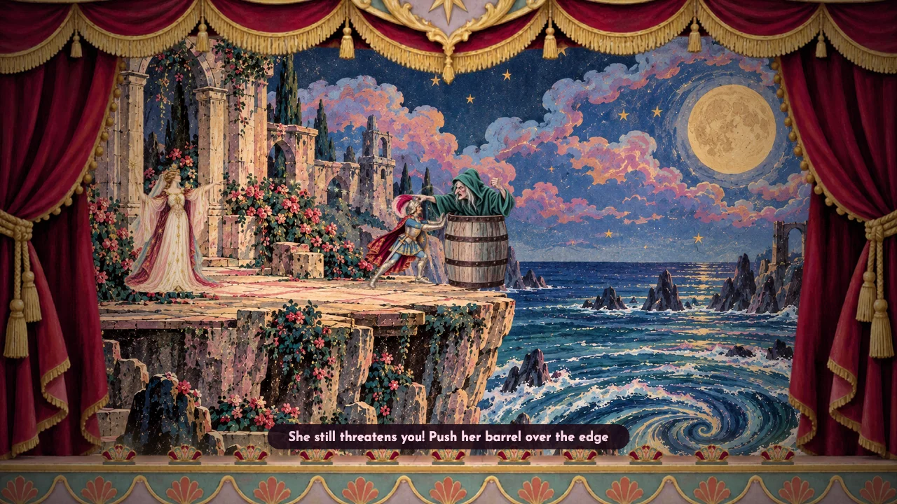
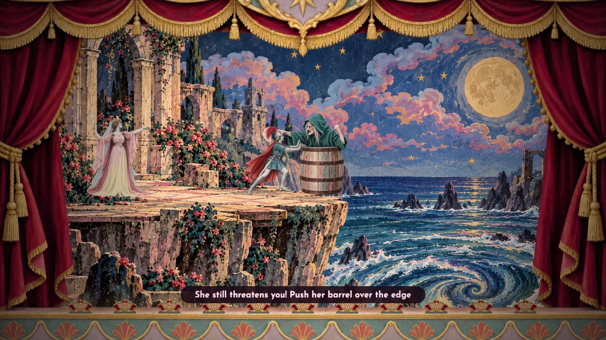
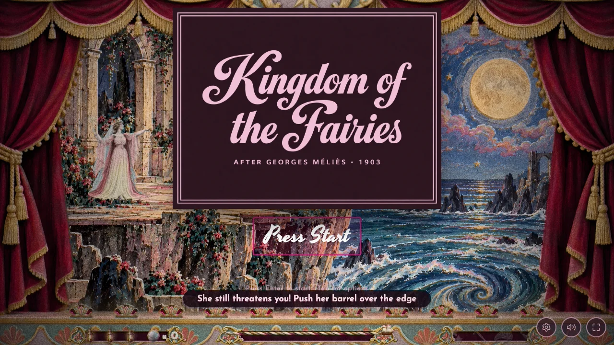

# The witch at the cliff edge — 31 October 2026

Aurora always faces right toward the witch. Her shield still converts fire
that passes the prince into harmless, short-lived smoke.

The witch stands at x 680, 70 stage pixels further toward the edge. Her barrel
is also placed there: its near wall is x 632 and far wall reaches the painted
cliff lip at x 728. The barrel collision half-width is 48 rather than 40.
It tips once its centre is pushed beyond the edge, as before.

Hits one and two move the prince back to the midpoint of the approach over
her 0.8-second recoil. Movement and another damaging strike are locked during
that shove. The shove itself costs no lantern. At its end she immediately
casts another ground-level fireball, with a short casting pose before her
usual attack cycle resumes. Walking straight back into that fireball is hit;
a fresh jump clears it. Hit three still starts Aurora's barrel spell.

The former recoil was painted about 171 stage pixels high while her standing
pose was 140 and her barrel smaller still. The scene now uses a 172-pixel
witch height for standing, casting, recoil and both barrel gestures, matching
the existing recoil's apparent size. `person_sizes.py` records manually
reviewed silhouette ratios for these poses, and all still draw through
`drawPerson`. Neither cast look grows on impact. The witch's unrelated
swoop/storm/fair-lady poses and other characters' measurements are unchanged.
[Person-size comparison](person-size-comparison.jpg).

The dropped barrel's opaque painted body is scaled to match the final large
barrel. The prince's pushing sprite is registered by its palm position, not
its canvas centre, placing his hands on the barrel's near wall below its rim.
His feet and standing character size stay registered to the ground.
No new bitmap generation or editing was needed.

Validation: 48 film checks; original/partial five-act suites; shared animation,
sailor-motion, walking, theme, assets-loader and finale suites; person-size
fingerprint. The browser checks every witch pose's painted height in both
looks, Aurora's direction, palm/barrel contact, then performs three separate
real keyboard jump approaches and wins with all three lanterns. The original
barrel-gesture/smoke browser regression also passes.
[Size and contact measurements](checks.json).

